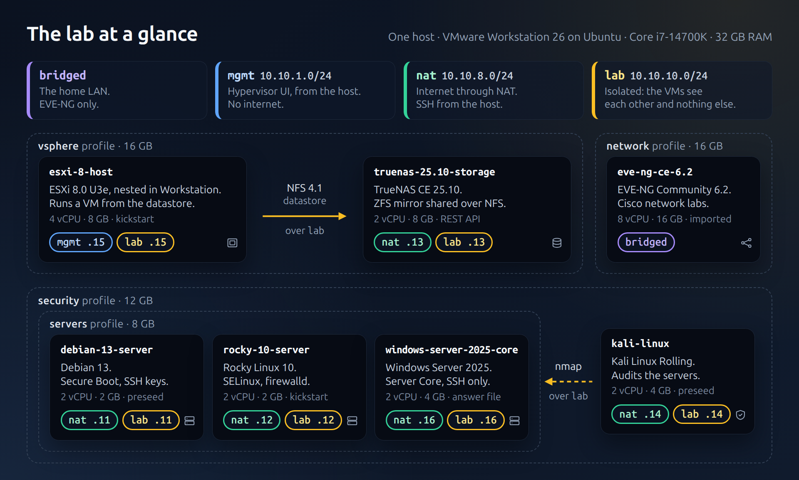
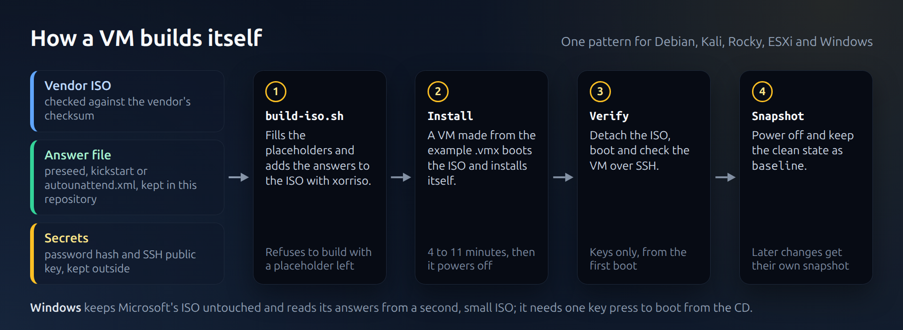
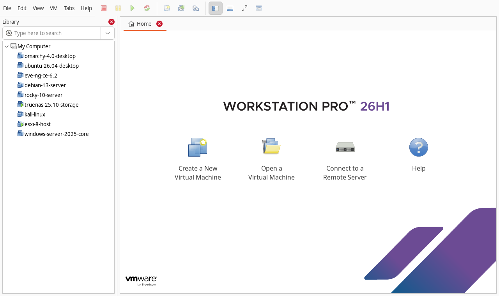
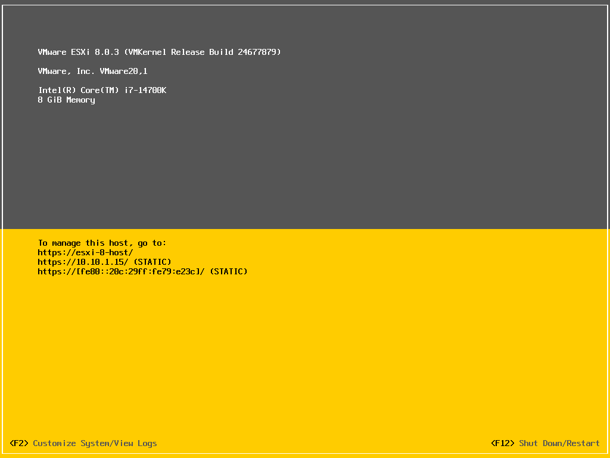
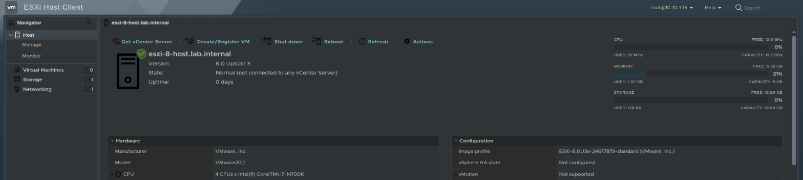
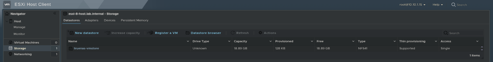
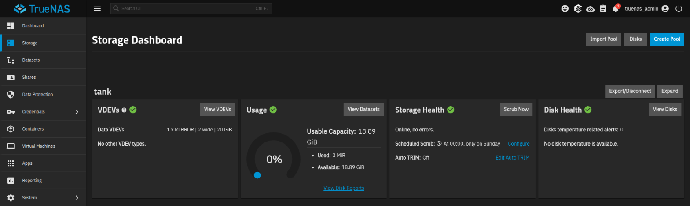

<h1 align="center">VMware Homelab</h1>

<p align="center">
  A VMware Workstation homelab that rebuilds itself:<br>
  nested ESXi 8 on TrueNAS NFS, five unattended installs and a Kali audit.
</p>

<p align="center">
  <a href="https://github.com/johan-socarras/VMware-Homelab/actions/workflows/checks.yml"></a>
  <a href="LICENSE"></a>
  <a href="LICENSE-docs"></a>
  
  
</p>

<p align="center">
  <a href="vms/README.md">Virtual machines</a> ·
  <a href="docs/network.md">Network</a> ·
  <a href="docs/unattended-installs.md">Unattended installs</a> ·
  <a href="docs/security-audit.md">Security audit</a> ·
  <a href="troubleshooting/README.md">Troubleshooting</a>
</p>



A virtualization lab on VMware Workstation: a nested ESXi host with shared NFS storage,
Linux and Windows servers built from unattended installs, an isolated lab network, and a
Kali VM that audits the rest from the inside. Five of the servers install themselves from
this repository in 4 to 11 minutes; the only input is one key press to boot Windows from
its CD.

**What it covers:**

- **vSphere:** ESXi 8 installed by kickstart, configured with `esxcli`, running a VM from an
  NFS datastore served by TrueNAS over a dedicated storage network.
- **Unattended installs** for five operating systems: Debian preseed, Kali preseed,
  Rocky kickstart, ESXi kickstart and a Windows `autounattend.xml` with a first-logon
  PowerShell script.
- **Hardening by default:** SSH with keys only from the first boot, root locked, SELinux and
  firewalld on Rocky, Windows Server Core with only SSH reachable.
- **Network design:** separate management, NAT and isolated lab networks with a consistent
  address plan.
- **Verification:** each VM documents how it was tested, and a port scan from Kali checks the
  hardening ([security audit](docs/security-audit.md)).

**What I learned building it:**

- When every boot medium fails the same way, the problem is the machine. A Windows VM
  could not boot any ISO because its guest type gave it 32-bit UEFI firmware
  ([TSH-04](troubleshooting/04-windows-guest-type-32-bit-efi.md)).
- Nested virtualization puts the outer hypervisor's switch in the network path. ESXi's
  storage port got no ARP replies until it used its uplink's MAC address
  ([TSH-03](troubleshooting/03-nested-esxi-vmkernel-mac.md)).
- A setting can be silently ignored. ESXi skipped an SSH option and rejected Ed25519 keys
  in FIPS mode; its own install log said so
  ([TSH-02](troubleshooting/02-esxi-ssh-fips-keys.md)).
- A clean install is not a working network: Kali's installer bound its network profile to
  nothing ([TSH-01](troubleshooting/01-kali-network-profile.md)).

> **A snapshot, not a live map.** This repository documents how the lab was designed and
> built. Passwords, keys and identifying details are left out, and the lab keeps changing
> after publication, so versions and details here may no longer match what runs today.

## Host

| | |
|---|---|
| Hypervisor | VMware Workstation 26 on Ubuntu |
| CPU | Intel Core i7-14700K (VT-x with EPT, used for nested virtualization) |
| RAM | 32 GB: one power profile at a time |
| Storage | VMs on an LVM volume across two SSDs, all disks thin provisioned |

## Virtual machines

| VM | What it demonstrates | OS | vCPU / RAM | Networks |
|---|---|---|---|---|
| [esxi-8-host](vms/esxi-8-host/README.md) | vSphere: nested ESXi, kickstart install, `esxcli`, NFS datastore, a VM running inside | VMware ESXi 8.0 U3e (free) | 4 / 8 GB | `mgmt` .15, `lab` .15 |
| [truenas-25.10-storage](vms/truenas-25.10-storage/README.md) | Shared storage: ZFS mirror, NFS limited to the lab network, configured through the REST API | TrueNAS CE 25.10 | 2 / 8 GB | `nat` .13, `lab` .13 |
| [debian-13-server](vms/debian-13-server/README.md) | Headless Linux server with Secure Boot and SSH keys only | Debian 13 | 2 / 2 GB | `nat` .11, `lab` .11 |
| [rocky-10-server](vms/rocky-10-server/README.md) | The Red Hat family: kickstart, SELinux enforcing, firewalld | Rocky Linux 10 | 2 / 2 GB | `nat` .12, `lab` .12 |
| [windows-server-2025-core](vms/windows-server-2025-core/README.md) | Windows Server with no desktop: answer file, PowerShell over SSH, only port 22 open | Windows Server 2025 Core (evaluation) | 2 / 4 GB | `nat` .16, `lab` .16 |
| [kali-linux](vms/kali-linux/README.md) | Security auditing of the lab from inside the isolated network | Kali Linux Rolling | 2 / 4 GB | `nat` .14, `lab` .14 |
| [eve-ng-ce-6.2](vms/eve-ng-ce-6.2/README.md) | Cisco network labs ([separate repository](https://github.com/johan-socarras/EVE-NG-Networking-Labs)) | EVE-NG Community 6.2 | 8 / 16 GB | `bridged` |

Every VM uses virtual hardware version 22. All but EVE-NG (imported as it was, see its
page) use UEFI, paravirtual NICs (vmxnet3), NVMe disks and no sound, USB or 3D, and have a
`baseline` snapshot taken powered off right after their install and checks.

The servers have a NIC on `nat` for updates and SSH from the host, and one on `lab`.
Details, address plan and isolation tests: [docs/network.md](docs/network.md).

## Power profiles

The host cannot run everything at once, so the VMs are grouped by what they are used for.
[`scripts/lab.sh`](scripts/lab.sh) starts a profile in order (TrueNAS before ESXi), shuts
it down in reverse, and snapshots it:

```text
$ scripts/lab.sh list
network    16 GB  eve-ng-ce-6.2
vsphere    16 GB  truenas-25.10-storage esxi-8-host
servers     8 GB  debian-13-server rocky-10-server windows-server-2025-core
security   12 GB  debian-13-server rocky-10-server windows-server-2025-core kali-linux

$ scripts/lab.sh start servers
$ scripts/lab.sh stop servers
$ scripts/lab.sh snapshot vsphere before-upgrade
```

With the `security` profile running:

```text
$ scripts/lab.sh status
debian-13-server           running
esxi-8-host                off
eve-ng-ce-6.2              off
kali-linux                 running
omarchy-4.0-desktop        off
rocky-10-server            running
truenas-25.10-storage      off
ubuntu-26.04-desktop       off
windows-server-2025-core   running

$ scripts/lab.sh stop security
kali-linux: shutting down
windows-server-2025-core: shutting down
rocky-10-server: shutting down
debian-13-server: shutting down
```

## Rebuild a VM

Each VM is built from the vendor's ISO and the files in its folder. Debian, for example:

```bash
./vms/debian-13-server/build-iso.sh debian-13.7.0-amd64-netinst.iso \
    ~/vmware/iso/debian-13-server-auto.iso /path/to/debian-13-server.hash ~/.ssh/id_ed25519.pub
mkdir -p ~/vmware/debian-13-server
cp vms/debian-13-server/debian-13-server.vmx.example ~/vmware/debian-13-server/debian-13-server.vmx
# attach the ISO in that .vmx, then:
vmware-vdiskmanager -c -s 20GB -a lsilogic -t 0 ~/vmware/debian-13-server/debian-13-server.vmdk
vmrun start ~/vmware/debian-13-server/debian-13-server.vmx nogui
# about 4 minutes later the VM is off: detach the ISO, boot, verify, snapshot
```



The full method, and what each installer needed: [Unattended installs](docs/unattended-installs.md).
The page of each VM has its own steps.

## Screenshots



The library in VMware Workstation, with the `vsphere` profile running. The two desktop
VMs, `omarchy-4.0-desktop` and `ubuntu-26.04-desktop`, are outside the scope of this
repository.



The nested ESXi host after its kickstart install, at the address the kickstart gave it.



The same host in the ESXi Host Client.



Its datastore, `truenas-vmstore`, mounted from TrueNAS over NFS 4.1.



The pool behind that datastore in TrueNAS: `tank`, a two-disk mirror.

## Documentation

| Document | Contents |
|---|---|
| [Network](docs/network.md) | The four virtual networks, address plan, pinned PCI slots, isolation tests |
| [Unattended installs](docs/unattended-installs.md) | The common pattern behind every build script, and what the installers taught me |
| [Security audit](docs/security-audit.md) | Port scans from Kali, what they found and how it was closed |
| [Naming](docs/naming.md) | How VMs, hosts and snapshots are named, and why |
| [Troubleshooting](troubleshooting/README.md) | The five write-ups below, with symptom, cause and lesson side by side |
| [TSH-01](troubleshooting/01-kali-network-profile.md) | Kali's first boot had no internet |
| [TSH-02](troubleshooting/02-esxi-ssh-fips-keys.md) | ESXi rejected my SSH key and still accepted passwords |
| [TSH-03](troubleshooting/03-nested-esxi-vmkernel-mac.md) | Nested ESXi could not reach the NFS server |
| [TSH-04](troubleshooting/04-windows-guest-type-32-bit-efi.md) | The Windows Server VM would not boot any ISO |
| [TSH-05](troubleshooting/05-truenas-network-rollback.md) | TrueNAS kept undoing its new IP addresses |

## Repository layout

```text
docs/             network, unattended installs, security audit, naming, images
scripts/          lab.sh (power profiles), export-vmx.py (shareable .vmx files),
                  check-links.py (run by the checks)
troubleshooting/  one write-up per real problem
vms/<vm>/         README, answer files and build scripts, <vm>.vmx.example
```

Each `<vm>.vmx.example` was exported from the working VM by
[`scripts/export-vmx.py`](scripts/export-vmx.py), which removes UUIDs, generated MAC
addresses and other per-machine values.

## Requirements

A Linux host with VMware Workstation (`vmrun`, `vmware-vdiskmanager`), `xorriso`, `openssl`
and Python 3. Nested ESXi also needs a CPU with VT-x and EPT (or AMD-V with RVI). The vendor
ISOs are not included: the page of each VM built from one names the exact file and how it
was checked.

## Secrets

No password, password hash or private key is in this repository. Answer files contain
placeholders (`@@USER_PASSWORD_HASH@@`, `@@ADMIN_PASSWORD@@`, `@@SSH_PUBLIC_KEY@@`) that the
build scripts fill in from files kept elsewhere, and they refuse to build an ISO with a
placeholder left. The built ISOs are never committed.

## License

Scripts and configuration files: [MIT](LICENSE). Documentation and images:
[CC BY 4.0](LICENSE-docs).
