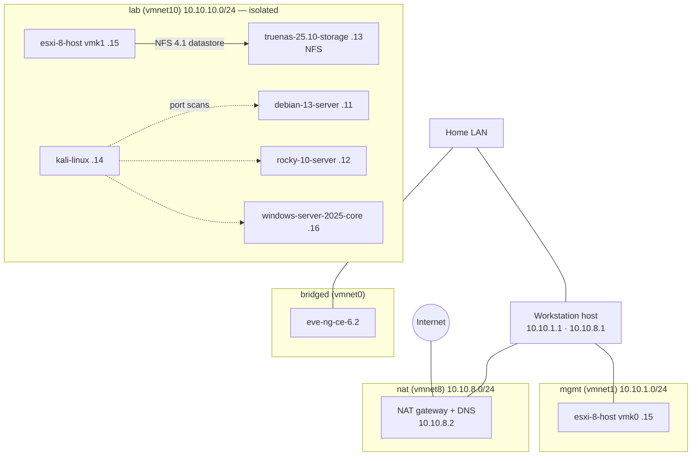

# Network

Four virtual networks, each with one job. VMware Workstation's defaults use randomly
chosen ranges; these were replaced with ranges whose third octet matches the network,
so an address tells you where it lives.

| VMware network | Name in this repo | Range | DHCP | Host address | Purpose |
|---|---|---|---|---|---|
| vmnet0 | `bridged` | the home LAN | the home router | — | EVE-NG only, so its web UI is reachable from any device at home |
| vmnet1 | `mgmt` | `10.10.1.0/24` | `.128`–`.254` | `10.10.1.1` | Management: hypervisor UIs reached from the host. No internet |
| vmnet8 | `nat` | `10.10.8.0/24` | `.128`–`.254` | `10.10.8.1` | Internet through Workstation's NAT (gateway and DNS at `.2`); SSH from the host |
| vmnet10 | `lab` | `10.10.10.0/24` | none | none | Isolated lab: VMs talk to each other and to nothing else |



## Address plan

Each VM keeps the same last octet on every network it joins:

| VM | `nat` | `lab` | `mgmt` |
|---|---|---|---|
| debian-13-server | `10.10.8.11` | `10.10.10.11` | |
| rocky-10-server | `10.10.8.12` | `10.10.10.12` | |
| truenas-25.10-storage | `10.10.8.13` (web UI) | `10.10.10.13` (NFS) | |
| kali-linux | `10.10.8.14` | `10.10.10.14` | |
| esxi-8-host | | `10.10.10.15` (`vmk1`, storage) | `10.10.1.15` (`vmk0`, Host Client) |
| windows-server-2025-core | `10.10.8.16` | `10.10.10.16` | |

The servers have two NICs: one on `nat`, which carries the default route, updates and
SSH from the host, and one on `lab` with no gateway. Since the host has no address on
`lab`, it manages lab VMs through their `nat` NIC. ESXi uses `mgmt` instead of `nat`
for management, so its Host Client is only reachable from the host.

## Pinned PCI slots

Linux names NICs after their PCI slot (`ens160`, `ens192`), so the `.vmx` pins the slots
and the answer files can name the interfaces before the VM exists. Debian, the first VM,
was built before that: its disk took slot 192, so its `lab` NIC sits in slot 224 and is
`ens224`. Every VM after it uses `ethernet0.pciSlotNumber = "160"`,
`ethernet1.pciSlotNumber = "192"` and the NVMe controller on 224. Windows has no such
names, so its two NICs get fixed MAC addresses instead and the setup script finds them by
MAC.

## How the networks were changed

With every VM powered off, a new `/etc/vmware/networking` file was written (the
`answer VNET_<n>_...` lines, without `DHCP_CFG_HASH` so that VMware regenerates
`dhcpd.conf` and `nat.conf`) and applied:

```bash
sudo vmware-networks --migrate-network-settings networking.new
sudo vmware-networks --start      # the migrate command stops the networks and does not restart them
```

## Isolation tests

- Debian and Rocky reach each other on `lab` (about 0.2 ms); from their `lab`
  interfaces neither `1.1.1.1` nor the home router answers.
- Windows: `ping -S 10.10.10.16 1.1.1.1` fails with "General failure" (no route).
- TrueNAS serves NFS on its `lab` address only: mounting through `10.10.8.13` fails.

## Verify

```bash
grep "^answer VNET_" /etc/vmware/networking   # subnets 10.10.1.0, 10.10.8.0, 10.10.10.0; VNET_10_DHCP no
ip -br addr | grep vmnet                      # vmnet1 10.10.1.1/24, vmnet8 10.10.8.1/24
```
