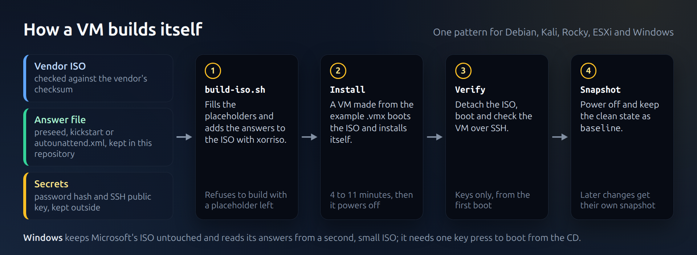

# Unattended installs

Every VM except EVE-NG (imported) and TrueNAS (its installer takes no answer file) is
installed without typing anything: boot the VM from an ISO, wait, and it powers itself off
when it is done. Windows only needs one key press to boot from its CD. Rebuilding a VM from
zero takes 4 to 11 minutes.



## The pattern

1. **Start from the vendor's ISO** and check it against the vendor's checksum.
2. **Write the answers in the installer's own format**, kept in this repository:

   | VM | Installer | Answer file | Install time | Typed by hand |
   |---|---|---|---|---|
   | debian-13-server | debian-installer | [`preseed.cfg`](../vms/debian-13-server/preseed.cfg) | about 4 min | nothing (its `lab` NIC was added afterwards) |
   | kali-linux | debian-installer + Kali's simple-cdd profile | [`preseed.cfg`](../vms/kali-linux/preseed.cfg) + [`finish.sh`](../vms/kali-linux/finish.sh) | 11 min | nothing |
   | rocky-10-server | Anaconda | [`ks.cfg`](../vms/rocky-10-server/ks.cfg) (kickstart) | about 4 min | nothing |
   | esxi-8-host | ESXi weasel | [`ks.cfg`](../vms/esxi-8-host/ks.cfg) (ESXi kickstart) | about 4 min | nothing |
   | windows-server-2025-core | Windows Setup | [`autounattend.xml`](../vms/windows-server-2025-core/autounattend.xml) + [`setup.ps1`](../vms/windows-server-2025-core/setup.ps1) | about 10 min | one key press to boot from the CD |

3. **Keep secrets out of the repository.** Answer files carry placeholders such as
   `@@USER_PASSWORD_HASH@@` or `@@ADMIN_PASSWORD@@`. Each VM's `build-iso.sh` fills them
   in from a file kept outside the repository (a SHA-512 crypt hash made with
   `openssl passwd -6`, or a plain password for Windows) and refuses to build if a
   placeholder is left.
4. **Build a new ISO with `xorriso`.** For the Linux and ESXi installers,
   `xorriso -indev <vendor.iso> -outdev <auto.iso> -map <file> <path> -boot_image any replay`
   adds the answer file and a boot entry that starts the automated install, and keeps the
   vendor's boot records, so UEFI and Secure Boot work as before. Windows is different: its
   ISO is UDF, so it is used untouched and a second small ISO carries the answer file.
5. **SSH with keys from the first boot.** The public key goes on the ISO and password
   logins are turned off before the VM ever reaches the network: `PasswordAuthentication
   no` and `KbdInteractiveAuthentication no` on Linux, `challengeresponseauthentication no`
   on ESXi, `PasswordAuthentication no` on Windows.
6. **Power off at the end** (`debian-installer/exit/poweroff`, `poweroff` in the
   kickstart, `Stop-Computer` in `setup.ps1`), so the host can tell the install finished
   by watching `vmrun list`.
7. **Check, then snapshot.** Detach the ISO, boot, verify over SSH, power off and take the
   `baseline` snapshot.

During the install, the VM's console is watched over a VNC server bound to `127.0.0.1`
(`RemoteDisplay.vnc.*` in the `.vmx`), which is removed afterwards.

## Example

```bash
# Debian: official netinst ISO -> unattended ISO -> VM
sha256sum -c --ignore-missing SHA256SUMS
./vms/debian-13-server/build-iso.sh debian-13.7.0-amd64-netinst.iso \
    ~/vmware/iso/debian-13-server-auto.iso /path/to/debian-13-server.hash ~/.ssh/id_ed25519.pub
mkdir -p ~/vmware/debian-13-server
cp vms/debian-13-server/debian-13-server.vmx.example ~/vmware/debian-13-server/debian-13-server.vmx
# in that .vmx, attach the ISO: sata0:1.deviceType = "cdrom-image",
#   sata0:1.fileName = "<full path of the auto ISO>", sata0:1.startConnected = "TRUE"
vmware-vdiskmanager -c -s 20GB -a lsilogic -t 0 ~/vmware/debian-13-server/debian-13-server.vmdk
vmrun start ~/vmware/debian-13-server/debian-13-server.vmx nogui
# about 4 minutes later the VM is off; detach the ISO, boot, verify, snapshot
```

## Things the installers taught me

- Network names depend on PCI slots; pin them in the `.vmx` ([network](network.md)).
- An installer can write a broken network profile and still report success
  ([TSH-01](../troubleshooting/01-kali-network-profile.md)).
- An ignored setting can look like an applied one: read the installer's log
  ([TSH-02](../troubleshooting/02-esxi-ssh-fips-keys.md)).
- The VM's guest type decides its firmware
  ([TSH-04](../troubleshooting/04-windows-guest-type-32-bit-efi.md)).
- Windows asks for a key press to boot from the CD. Pressing keys for too long reaches
  Setup's own screen: a stray Enter once landed on "Cancel".
