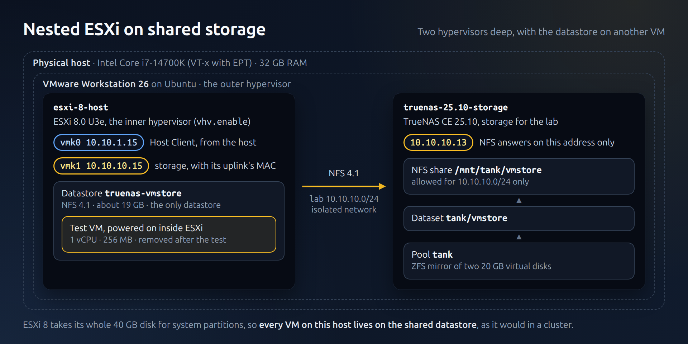

# TSH-03 — Nested ESXi could not reach the NFS server

## Symptom

[esxi-8-host](../vms/esxi-8-host/README.md) has a second VMkernel port, `vmk1`
(`10.10.10.15`), on the `lab` network, to reach the TrueNAS NFS share at
`10.10.10.13`. TrueNAS answered ping from the host and from other VMs on `lab`, but
not from ESXi:

```text
[root@esxi-8-host:~] vmkping -I vmk1 -c2 10.10.10.13
sendto() failed (Host is down)
[root@esxi-8-host:~] esxcli network ip neighbor list
10.10.10.13  (incomplete)  vmk1  0 sec  Invalid
```

The management port `vmk0` worked fine.



The picture shows the path once it worked: `vmk1` to TrueNAS across `lab`.

## Cause

`vmk0` takes the MAC address of its uplink, `vmnic0`, which is the MAC of the
Workstation virtual NIC. A VMkernel port created later, like `vmk1`, gets a MAC that
ESXi generates (`00:50:56:...`). Workstation delivers to a VM only the frames
addressed to its virtual NIC's own MAC unless the VM is allowed into promiscuous mode
on the host. So TrueNAS's ARP replies to `vmk1`'s MAC were never handed to the VM.

## Fix

Create `vmk1` with the MAC of its uplink, `vmnic1`, the same way `vmk0` uses
`vmnic0`'s. In the kickstart's `%firstboot` section:

```bash
VMNIC1_MAC=$(esxcfg-nics -l | awk '$1=="vmnic1"{print $7}')
esxcli network ip interface add -i vmk1 -p Storage -M "$VMNIC1_MAC"
esxcli network ip interface ipv4 set -i vmk1 -t static -I 10.10.10.15 -N 255.255.255.0
```

This needs no change on the host. The alternative, letting the VM use promiscuous
mode (write access to `/dev/vmnet10` for the user running the VM), would also be
needed for nested VMs with their own network cards; this lab does not need it.

## Result

`vmkping -I vmk1` to `10.10.10.13` answers in about 0.3 ms, the NFS datastore mounts
over NFS 4.1, and the setup is the same after a reinstall from scratch and after a
reboot.

## Lesson

In nested virtualization, the outer hypervisor's switch is part of the network path.
When ARP stays `incomplete`, check which MAC the frames are addressed to and whether
the outer layer will deliver them.
