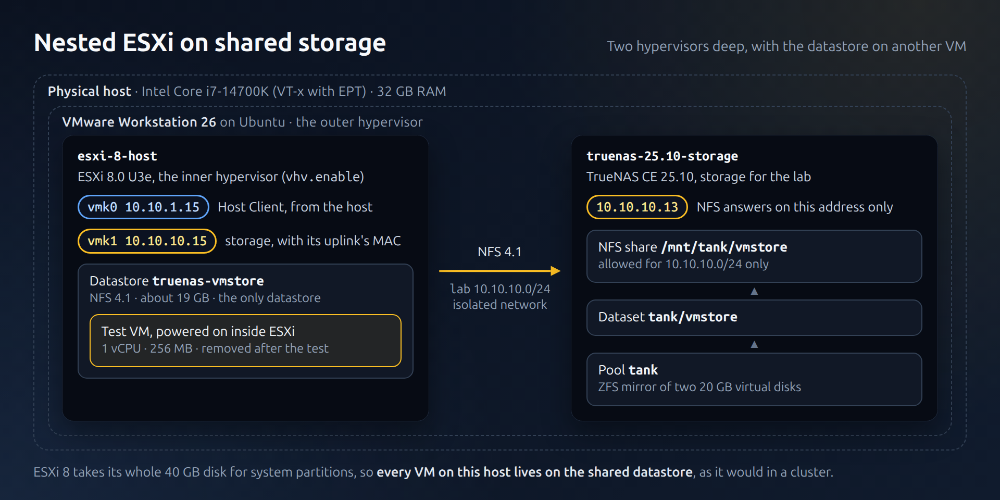
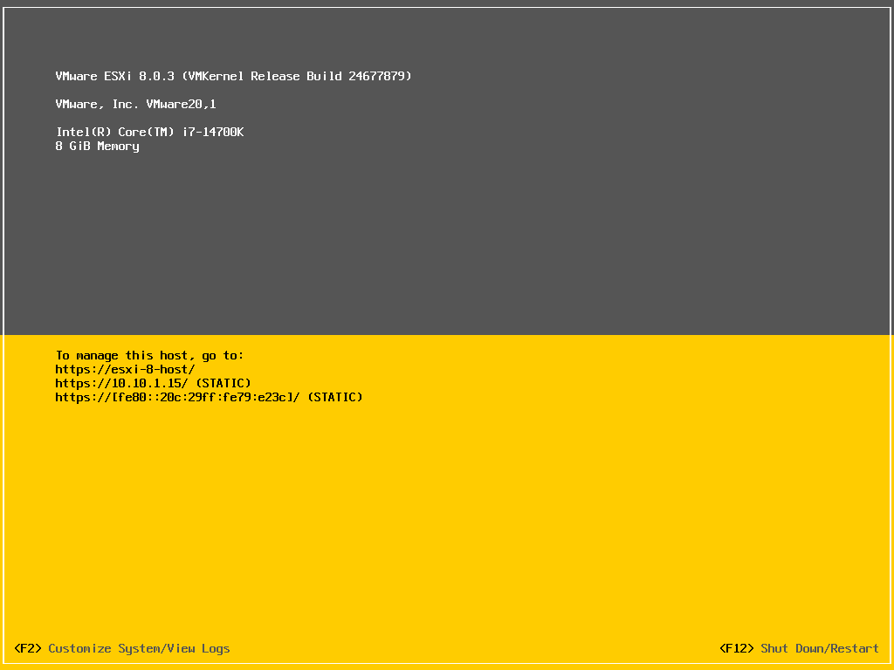

# esxi-8-host

vSphere inside Workstation: a nested ESXi host, installed by kickstart, with the
TrueNAS NFS share as its datastore and a test VM powered on from it. ESXi 8 takes
the whole 40 GB disk for its system partitions and leaves no local datastore, so
every VM on this host lives on shared storage, as it would in a cluster.



| | |
|---|---|
| Guest OS | VMware ESXi 8.0 Update 3e, build 24677879, free edition ("VMware vSphere Hypervisor"); its API is read-only, so configuration is done with `esxcli` over SSH |
| Hardware | Virtual hardware 22, guest type `vmkernel8`, UEFI, nested virtualization (`vhv.enable = "TRUE"`), 40 GB NVMe disk (thin) |
| CPU / RAM | 4 vCPU, 8 GB |
| Network | `vmnic0` on `mgmt`: `vSwitch0`, `vmk0` `10.10.1.15` (Host Client at `https://10.10.1.15`)<br>`vmnic1` on `lab`: `vSwitch1`, port group `Storage`, `vmk1` `10.10.10.15` |
| Storage | Datastore `truenas-vmstore`: NFS 4.1 from `10.10.10.13:/mnt/tank/vmstore`, about 19 GB |
| Access | `root`: password for the Host Client and the console only; SSH with an **ECDSA** key only |
| Power profile | `vsphere`, after TrueNAS |

## How it is built

1. Download `VMware-VMvisor-Installer-8.0U3e-24677879.x86_64.iso` from the Broadcom
   support portal (free downloads, with a Broadcom account) and check its SHA256.
2. Build the unattended ISO with a SHA-512 crypt root password hash and an **ECDSA or
   RSA** public key (the script refuses Ed25519, see below):
   ```bash
   ssh-keygen -t ecdsa -b 256 -f ~/.ssh/id_ecdsa
   ./build-iso.sh VMware-VMvisor-Installer-8.0U3e-24677879.x86_64.iso esxi-8-host-auto.iso \
       /path/to/esxi-8-host.hash ~/.ssh/id_ecdsa.pub
   ```
   [`build-iso.sh`](build-iso.sh) adds `KS.CFG` from [`ks.cfg`](ks.cfg) and rewrites
   `BOOT.CFG` (the same file serves BIOS and UEFI boot) to start with
   `ks=cdrom:/KS.CFG`.
3. Create the VM from [`esxi-8-host.vmx.example`](esxi-8-host.vmx.example) and boot it
   from the ISO. The install takes about 4 minutes; ESXi ejects the CD and boots from
   disk, and the kickstart's `%firstboot` section sets up SSH and the storage network.
4. With TrueNAS running, mount the datastore:
   ```bash
   ./configure.sh            # defaults to 10.10.1.15
   ```
   This is kept out of the kickstart because TrueNAS does not have to be running while
   ESXi installs.
5. Power off, detach the ISO and take the `baseline` snapshot.

## What it took

Three problems showed up on the first install. All three are fixed in `ks.cfg` and
were confirmed with a second install from scratch:

1. **ESXi 8 runs its SSH server in FIPS 140 mode** and rejects Ed25519 keys. FIPS
   was left on, as shipped, and the host uses an ECDSA key
   ([TSH-02](../../troubleshooting/02-esxi-ssh-fips-keys.md)).
2. **`passwordauthentication` is not a configurable SSH setting on ESXi**: the
   kickstart log said `Ignored key`. Passwords come in through keyboard-interactive
   (PAM), so `challengeresponseauthentication` is what gets turned off (same TSH).
3. **`vmk1` never got an ARP reply from TrueNAS.** Workstation only delivers frames
   addressed to the virtual NIC's own MAC, and a new VMkernel port gets a generated
   one. `vmk1` is created with `vmnic1`'s MAC, the same way `vmk0` uses `vmnic0`'s
   ([TSH-03](../../troubleshooting/03-nested-esxi-vmkernel-mac.md)).

## Tests

- Host Client answers on `https://10.10.1.15` (HTTP 200).
- SSH as root with the key works; with the password it gets `Permission denied (publickey)`.
- The NFS datastore mounts over `vmk1`, and a 64 MB write and delete succeed.
- A minimal VM (1 vCPU, 256 MB, no OS) created on the datastore **powered on inside
  ESXi** with hardware-assisted virtualization (`Monitor Mode: CPL0` in its log), and
  was then removed.
- After rebooting ESXi the key, `vmk1` with its MAC and the datastore were all still there.

Nested VMs run, but a nested VM with a network card would also need promiscuous mode
on the host's `/dev/vmnet*` devices, which this lab does not change.

## Verify

```bash
vmrun start ~/vmware/esxi-8-host/esxi-8-host.vmx nogui     # with TrueNAS already running
ssh root@10.10.1.15 'vmware -v; esxcli storage nfs41 list; vmkping -I vmk1 -c1 10.10.10.13'
# VMware ESXi 8.0.3 build-24677879, truenas-vmstore mounted and accessible, reply from 10.10.10.13
```



## Files

| File | What it is |
|---|---|
| [`ks.cfg`](ks.cfg) | Kickstart: EULA, disk, root password hash, management network; `%firstboot` for SSH and the storage vSwitch |
| [`build-iso.sh`](build-iso.sh) | Builds the unattended ISO from the official installer ISO |
| [`configure.sh`](configure.sh) | Mounts the TrueNAS NFS share as a datastore over SSH |
| [`esxi-8-host.vmx.example`](esxi-8-host.vmx.example) | The VM's configuration, exported with [`scripts/export-vmx.py`](../../scripts/export-vmx.py) |

**Snapshots:** `baseline`.
